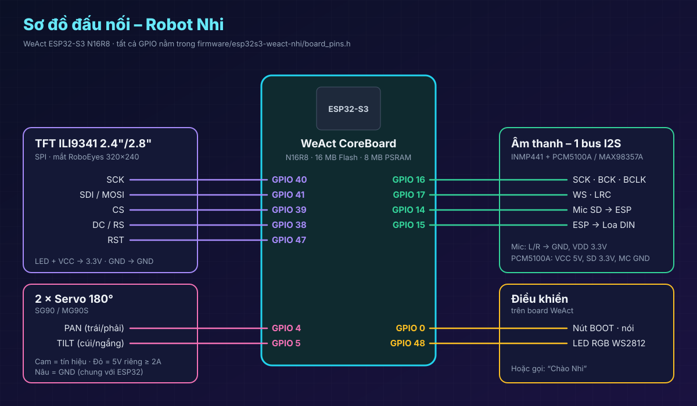

<p align="center">
  
</p>

<p align="center">
  
  
  
  
</p>

# Nhi – Robot trợ lý AI để bàn

Robot nhỏ gọn đặt trên bàn, **trò chuyện bằng tiếng Việt** và **thể hiện cảm xúc** bằng đôi mắt
hoạt hình trên màn hình TFT kết hợp **cái đầu quay bằng 2 servo** (trái/phải, cúi/ngẩng).
Mục tiêu không phải robot nhiều chức năng, mà là robot dễ thương, tương tác tự nhiên và hoàn thiện được.

Firmware là một board riêng (`esp32s3-weact-nhi`) cho
[78/xiaozhi-esp32](https://github.com/78/xiaozhi-esp32), tách ra từ dự án robot chó
[gwaen-jung/esp32s3_weact_xiaozhirobot](https://github.com/gwaen-jung/esp32s3_weact_xiaozhirobot)
(dùng lại sơ đồ chân đã chạy thử thành công trên mạch).

## Tính năng

| | |
|---|---|
| 🗣️ **Trò chuyện AI tiếng Việt** | Mic INMP441 → ESP32-S3 → server qua Wi-Fi → trả lời qua loa |
| 👋 **Đánh thức bằng giọng nói** | Gọi **“Chào Nhi”** (wake word MultiNet) hoặc nhấn nút **BOOT** |
| 👀 **Biểu cảm khuôn mặt** | Mắt RoboEyes 24 biểu cảm, màu đổi mượt theo cảm xúc, hiệu ứng ! ? Zzz tim nước mắt |
| 🤖 **Đầu chuyển động theo cảm xúc** | Servo PAN + TILT phối hợp với mắt, tăng/giảm tốc mượt, không vượt giới hạn cơ khí |
| 😴 **Chế độ nghỉ tự nhiên** | Tự chớp mắt, nhìn quanh, thỉnh thoảng quay đầu nhẹ, lâu không ai nói thì buồn ngủ |

## Mắt + đầu theo từng trạng thái

| Trạng thái | Biểu cảm mắt | Chuyển động đầu |
|---|---|---|
| Bình thường | Chớp mắt, nhìn quanh | Thỉnh thoảng quay nhẹ theo hướng nhìn |
| Vui vẻ | Mắt cười, màu vàng | Lắc trái/phải vui nhộn |
| Buồn | Mắt cụp, màu xanh | Cúi đầu chậm |
| Tức giận | Mắt cau, màu đỏ | Lắc đầu ngắn |
| Ngạc nhiên | Mở to, dấu “!” | Ngẩng lên |
| Suy nghĩ | Nhìn lệch, dấu “?” | Quay lệch một phía |
| Đang nghe | Mở to, tập trung | Ngẩng nhẹ |
| Đang nói | Giữ biểu cảm phù hợp | Gật / đung đưa nhẹ |
| Buồn ngủ | Lim dim, Zzz | Cúi nhẹ rồi giữ yên |

Bảng ánh xạ cảm xúc nằm trong [`nhi_behavior.cc`](firmware/esp32s3-weact-nhi/nhi_behavior.cc),
các động tác đầu trong [`head_servos.cc`](firmware/esp32s3-weact-nhi/head_servos.cc).

## Phần cứng

<p align="center">
  
</p>

| Linh kiện | Chức năng | GPIO |
|---|---|---|
| WeAct ESP32-S3 N16R8 | Bộ điều khiển trung tâm, Wi-Fi | – |
| TFT ILI9341 2.4"/2.8" (SPI) | Đôi mắt RoboEyes | SCK 40 · MOSI 41 · CS 39 · DC 38 · RST 47 |
| Mic INMP441 | Thu giọng nói | SCK 16 · WS 17 · SD 14 |
| PCM5100A (WeAct I2S Speaker) hoặc MAX98357A | Loa | BCK 16 · WS 17 · DIN 15 |
| Servo PAN | Quay trái/phải | 4 |
| Servo TILT | Cúi/ngẩng | 5 |
| Nút BOOT | Nói / ngắt lời | 0 |
| LED RGB WS2812 | Trạng thái | 48 |

> [!IMPORTANT]
> - Servo dùng **nguồn 5V riêng ≥ 2A**, nối **GND chung** với ESP32.
> - Cả 2 servo phải là loại **180°**. Lắp cánh tay servo khi robot đã đưa đầu về giữa (90°).
> - Mạch đi dây âm thanh khác? Chỉ cần sửa 4 dòng `PIN_I2S_*` trong
>   [`board_pins.h`](firmware/esp32s3-weact-nhi/board_pins.h).

Không dùng: camera, nhận diện cử chỉ, cảm biến khoảng cách, bánh xe hay chân robot.

## Build và nạp firmware

Cần **ESP-IDF v6.0.1+** (đã build thử với v6.0.1 trên Windows).

```powershell
git clone https://github.com/78/xiaozhi-esp32.git
cd xiaozhi-esp32
git checkout c0fe42a
git am ..\esp32s3-weact-nhi\patches\*.patch
python scripts/build.py esp32s3-weact-nhi --language vi-VN
idf.py -p COM8 flash monitor
```

Sau khi đã áp patch, mỗi lần sửa code trong `firmware/` chỉ cần:

```powershell
.\scripts\build_flash.ps1 -XiaozhiDir ..\xiaozhi-esp32 -Port COM8 -SyncBoard
```

Lần đầu khởi động: robot phát Wi-Fi `Xiaozhi-XXXX` → vào `http://192.168.4.1` nhập Wi-Fi →
robot đọc mã 6 số → thêm thiết bị trên server (mặc định xiaozhi.me).

## Căn chỉnh servo

Mọi thông số nằm trong [`nhi_config.h`](firmware/esp32s3-weact-nhi/nhi_config.h):

```c
// gpio, trim_deg, invert, min_deg, max_deg, detach_idle
static constexpr AxisConfig kAxisConfig[AXIS_COUNT] = {
    {PIN_SERVO_PAN, 0, false, 50, 130, true},
    {PIN_SERVO_TILT, 0, false, 70, 115, false},
};
```

- Đầu lệch khi nhìn thẳng → chỉnh `trim_deg`.
- Quay ngược chiều → `invert = true`.
- Chạm khung → thu hẹp `min_deg` / `max_deg`.
- Muốn thử mắt và giọng nói trước khi lắp servo → `NHI_SERVOS_ENABLED 0`.

Chi tiết: [`firmware/esp32s3-weact-nhi/README.md`](firmware/esp32s3-weact-nhi/README.md).

## Cấu trúc repo

```
firmware/esp32s3-weact-nhi/   mã nguồn board (copy vào main/boards/ của xiaozhi-esp32)
patches/                      patch git am trên xiaozhi-esp32 @ c0fe42a (board + Kconfig/CMake)
scripts/build_flash.ps1       build + nạp trên Windows
docs/                         banner, sơ đồ đấu nối
```

## Nguồn tham khảo

- [78/xiaozhi-esp32](https://github.com/78/xiaozhi-esp32) – firmware nền cho ESP32-S3 (MIT)
- [gwaen-jung/esp32s3_weact_xiaozhirobot](https://github.com/gwaen-jung/esp32s3_weact_xiaozhirobot) – cấu hình linh kiện đã thử trên PCB
- [huyhoa308/ai-robot](https://github.com/huyhoa308/ai-robot) – chatbot Nhi, RoboEyes và biểu cảm
- [FluxGarage RoboEyes](https://github.com/FluxGarage/RoboEyes) – thư viện mắt gốc

## Giấy phép

Phần mắt là bản port của FluxGarage RoboEyes (GPL-3.0-or-later), nên firmware build ra là
**GPL-3.0** ([LICENSE](LICENSE)). Upstream xiaozhi-esp32 là MIT.
